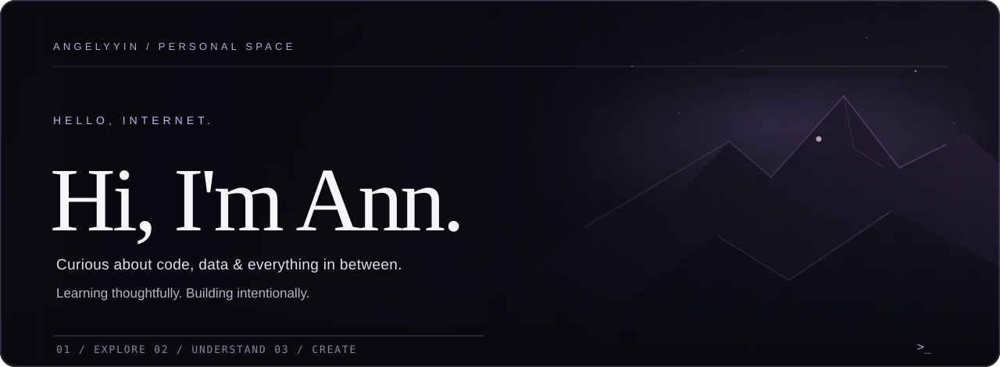

<div align="center">



</div>

<br />

### A little about me

I'm **Ann** — curious about how things work, especially when data, systems and thoughtful engineering come together.

I like exploring the details, understanding the *why* behind the code, and turning what I learn into something real. This is my space to document that process — one experiment, one problem and one project at a time.

<br />

### My toolbox

<table>
  <tr><td><strong>Languages & web</strong></td><td>Python · Java · SQL · HTML · CSS</td></tr>
  <tr><td><strong>Databases</strong></td><td>MongoDB · PostgreSQL</td></tr>
  <tr><td><strong>Tools</strong></td><td>Git · GitHub · Terminal</td></tr>
</table>

<sub>Some tools are part of my active learning journey — this is a growing toolbox, not a list of expert claims.</sub>

<br />
<br />

### Currently exploring

```text
~/ann
  ├── data/        MongoDB · PostgreSQL · SQL
  ├── code/        Python · Java
  ├── foundations/ databases · systems · problem-solving
  └── projects/    coming as I build them
```

<br />

### Projects

A collection in progress. I'll share meaningful work here as it takes shape.

<br />

---

<div align="center">
  <sub><code>stay curious · make things · keep learning</code></sub>
</div>
